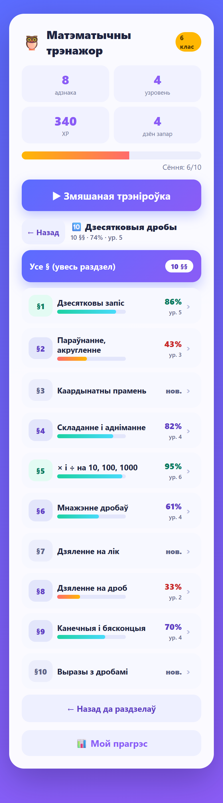
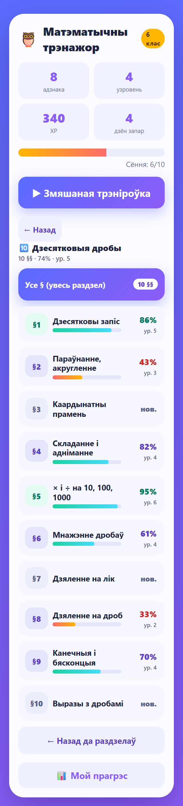

# Дызайн-спека: двух'узроўневы выбар «раздзел → §»

Статус: **as-built** — апісвае тое, што ўжо сабрана ў `index.html` + `styles.css` + `app.js` (праверана рэндэрам, гл. §3.6). Гэта дакумент для 1:1-зверкі і для наступных змен.
Крыніцы: `docs/SUBS.md` (38 §§), `docs/spec-sub.md` (паводзіны), `docs/data-model-sub.md` (`mt6_state_v3`, `subs[]`).

Ключавое: `spec-sub.md` прапаноўваў асобны экран `#screen-sub`; у рэалізацыі §-выбар зроблены **станам галоўнай** (`#sub-panel` унутры `#screen-home`). Гэта зафіксавана ў **§15** разам з табліцай адпаведнасці id — калі трэба вярнуцца да варыянту спеки, дэльта распісаная.

---

## 0. TL;DR

| Што | Дзе | id / клас |
|---|---|---|
| Абгортка картак раздзелаў (хаваецца) | `#screen-home` | `#home-chapters` |
| §-панэль (схаваная па змаўчанні) | пасля `#home-chapters` | `#sub-panel.hidden[role=region]` |
| Верхні радок | у панэлі | `#sub-head` → `#sub-back` + `#sub-titles` |
| «← Назад» | у `#sub-head` | `#sub-back.btn.btn-ghost.btn-back` (текст, 44 px) |
| Загаловак | у `#sub-titles` | `h2#sub-title[tabindex=-1]` + `#sub-chapter-meta` |
| «Усе § (увесь раздзел)» | пад загалоўкам | `#sub-all.btn.btn-primary` + `#sub-all-meta.sa-meta` |
| Спіс §§ | пад CTA | `ul#sub-list` → `li > button.sub-item` |
| Пункт § | у спісе | `id="sub-item-<chapter>-<S>"`, `data-scope`, `data-state`; унутры `.si-num`, `.si-body(.si-name + .si-bar)`, `.si-meta(.si-pct + .si-lvl)`, `.si-arrow` |
| «← Назад да раздзелаў» | унізе панэлі | `#sub-back-bottom.btn.btn-ghost.btn-back-bottom` |
| «Раздзел · §N» | экран пытання | `#q-topic` = `🔟 Дзесятковыя дробы · §4` |
| Плашка выніку | экран выніку | `#res-scope.res-scope` |
| Дашборд па §§ | `#screen-stats` | `#stats-chapter-tabs.chip-row` + `#stats-sub-bars.sub-bars` |
| Банер памылкі | `#screen-home`, першым | `#gen-error.banner.hidden[role=alert]` |

Запуск: § → `startSession('decimals:S4')`; «Усе §» → `startSession('decimals')`; «Змяшаная» → `startSession('mix')`.
Клік па `.topic-card` **не запускае сесію** — ён робіць `openSubPanel(chapter)`.

---

## 1. Прынцыпы

1. **Два клікі да задачы.** Галоўная → раздзел → § → пытанне. «Усе §» скарачае другі крок да аднаго тапа.
2. **Панэль — стан галоўнай, а не новы экран.** Галоўная картка, стэтыстыка, «Змяшаная» і «Мой прагрэс» застаюцца на месцы; замяняецца толькі зона раздзелаў. Кантэкст (узровень, XP, мэта дня) не губляецца, і не трэба дадаваць экран у `show()`.
3. **Буйныя тап-зоны.** Пункт § — **62 px** (замерана), «Усе §» — **56 px**, `#sub-back` — **44 px**, `#sub-back-bottom` — **48 px**.
4. **Стан чытаецца тэкстам, а не толькі колерам:** працэнт лічбай + «ур. N» + паласа.
5. **Беларуская мова ва ўсім новым UI.**
6. **Ніякіх новых залежнасцей.** Чысты CSS + DOM.

---

## 2. User flow

```
[Галоўная #screen-home: 6 картак раздзелаў]
        │ tap .topic-card[data-chapter]
        ▼
[#home-chapters.hidden]  [#sub-panel бачны]
   ├─ «← Назад» / «← Назад да раздзелаў» ───► show('screen-home'), фокус на картку
   ├─ «Усе § (увесь раздзел)» ───────────────► startSession('decimals')
   └─ tap «§4 Складанне і адніманне 82%» ────► startSession('decimals:S4')
                                                     │
                                                     ▼
                                    [«🔟 Дзесятковыя дробы · §4»]
                                                     │ «←» (#quiz-quit)
                                                     ▼
                                    [Галоўная + #sub-panel таго ж раздзела]
```

Правілы вяртання (як у рэалізацыі):
- `#quiz-quit` → `renderHome()`; калі сесія была па § ці раздзеле — панэль таго ж раздзела адкрываецца зноў (`renderHome(openChapter)`).
- `#res-home` → галоўная з закрытай панэллю.
- `#res-again` → паўтор таго ж `session.scope`.
- `#res-change` («🔀 Іншы §») → галоўная з адкрытай панэллю свайго раздзела; схаваная для `mix`.
- `Esc` → закрыць панэль (толькі калі яна адкрытая).

---

## 3. Wireframe

### 3.1 Галоўная, панэль зачынена

```
┌──────────────────────────────────────────┐ 390 px
│ 🦉 Матэматычны трэнажор        [6 клас]  │  .brand
│ ┌──────┐┌──────┐┌──────┐┌──────┐        │  .stats-row
│ │  8   ││  4   ││ 340  ││  4   │        │
│ └──────┘└──────┘└──────┘└──────┘        │
│ ▓▓▓▓▓▓▓▓▓░░░░░░░        Сёння: 6/10      │  .daily
│ ┌──────────────────────────────────────┐│
│ │        ▶ Змяшаная трэніроўка         ││  #start-mix
│ └──────────────────────────────────────┘│
│ Або абяры раздзел падручніка:            │  .section-title
│ ┌────────────────┐┌────────────────┐    │
│ │      🔟        ││       💯       │    │  .topic-card + .tc-open
│ │ Дзесятковыя    ││  Працэнты і    │    │
│ │    дробы       ││  прапорцыі     │    │
│ │ 74% • ур. 5    ││  91% • ур. 4   │    │
│ │ выбраць § →    ││ выбраць § →    │    │
│ └────────────────┘└────────────────┘    │
│            … 6 картак …                  │
│ ┌──────────────────────────────────────┐│
│ │          📊 Мой прагрэс              ││  #open-stats
│ └──────────────────────────────────────┘│
└──────────────────────────────────────────┘
```

### 3.2 §-панэль (`#sub-panel`)

```
┌──────────────────────────────────────────┐
│ 🦉 Матэматычны трэнажор        [6 клас]  │  ← бяз змен
│ [8 адзнака][4 узровень][340 XP][4 дзён]  │
│ ▓▓▓▓▓▓▓░░░░░░           Сёння: 6/10      │
│ ┌──────────────────────────────────────┐ │
│ │      ▶ Змяшаная трэніроўка           │ │
│ └──────────────────────────────────────┘ │
│ ┌──────────────────────────────────────┐ │  #sub-head
│ │ ┌───────────┐  🔟 Дзесятковыя дробы  │ │  #sub-back / #sub-title
│ │ │ ← Назад   │  10 §§ · 74% · ур. 5   │ │  #sub-chapter-meta
│ │ └───────────┘                         │ │
│ └──────────────────────────────────────┘ │
│ ┌──────────────────────────────────────┐ │
│ │ Усе § (увесь раздзел)        [10 §§] │ │  #sub-all (.btn-primary)
│ └──────────────────────────────────────┘ │
│ ┌──────────────────────────────────────┐ │
│ │[§1] Дзесятковы запіс          86%  › │ │  .sub-item[data-state=strong]
│ │     ▓▓▓▓▓▓▓▓▓░               ур. 5   │ │
│ ├──────────────────────────────────────┤ │
│ │[§2] Параўнанне, акругленне    43%  › │ │  .sub-item[data-state=weak]
│ │     ▓▓▓▓░░░░░░░              ур. 3   │ │
│ ├──────────────────────────────────────┤ │
│ │[§3] Каардынатны прамень      нов.  › │ │  .sub-item[data-state=new]
│ ├──────────────────────────────────────┤ │
│ │[§4] Складанне і адніманне     82%  › │ │  .sub-item[data-state=ok]
│ │     ▓▓▓▓▓▓▓▓░░               ур. 4   │ │
│ │  … §5–§10 …                          │ │
│ └──────────────────────────────────────┘ │
│ ┌──────────────────────────────────────┐ │
│ │      ← Назад да раздзелаў            │ │  #sub-back-bottom (.btn-ghost)
│ └──────────────────────────────────────┘ │
│ ┌──────────────────────────────────────┐ │
│ │          📊 Мой прагрэс              │ │  ← бяз змен
│ └──────────────────────────────────────┘ │
└──────────────────────────────────────────┘
```

Колькі змяшчаецца: загаловак 52 px + CTA 56 px + 10 пунктаў × 62 px. Пры 10 §§ спіс пракручваецца — таму «Назад» дубліраваны ўнізе.

Загаловак **не sticky** — свядома: `body{overflow-x:hidden}` робіць `position:sticky` далікатным у розных браўзерах; замест гэтага кнопка ўнізе.

### 3.3 Экран пытання — «Раздзел · §N»

```
┌──────────────────────────────────────────┐
│ [←]  🔟 Дзесятковыя дробы · §4    4 / 10 │  .quiz-top
│ ▓▓▓▓▓▓░░░░░░░░░░░░░░░░░░░░░░░░░░░░░░░░░░ │  #quiz-fill
│                  🦉                       │
│ ┌──────────────────────────────────────┐ │
│ │          2,4 · 10 = ?                │ │  #question
│ └──────────────────────────────────────┘ │
│ ┌──────────────────────────────────────┐ │
│ │            Твой адказ                │ │  #answer
│ └──────────────────────────────────────┘ │
│ ┌──────────────────────────────────────┐ │
│ │             Праверыць               │ │  #submit-btn
│ └──────────────────────────────────────┘ │
└──────────────────────────────────────────┘
```

`#q-topic` (як у рэалізацыі, `topicLabel()`):

| Рэжым | Значэнне |
|---|---|
| выбрана § | `🔟 Дзесятковыя дробы · §4` |
| увесь раздзел | `🔟 Дзесятковыя дробы · усе §` |
| змяшаная | `🔟 Дзесятковыя дробы · §4` (раздзел і § бягучага пытання) |

- `·` (U+00B7) з прабеламі; `§` (U+00A7) без прабелу і без вядучага нуля.
- `title` = поўны тэкст (пры абрэзцы).

### 3.4 Экран выніку — плашка §

```
│ 🏁
│  9 /10
│ ┌────────────────────────────────┐
│ │ §4 · Складанне і адніманне     │   ← #res-scope (div.res-scope)
│ └────────────────────────────────┘
│ Выдатна! Яшчэ крыху да 10! 🚀
│ [90%][9/10][+140 XP]
│ [ 🔁 Яшчэ раз ]
│ [ 🔀 Іншы § ]      ← #res-change (схаваны для mix)
│ [🏠 На галоўную] [📊 Дашборд]
```

Змест `#res-scope` (`scopeLabel()`): `§N · кароткая назва` / `Усе § · назва раздзела` / `Змяшаная трэніроўка`.

### 3.5 Банер памылкі (`#gen-error`)

```
┌──────────────────────────────────────────┐
│ Не атрымалася загрузіць задачы.          │  #gen-error.banner[role=alert]
│ Абнаві старонку.                         │
└──────────────────────────────────────────┘
```
Паказваецца, калі няма `window.GEN_BY_SUB`; карткі раздзелаў тады `disabled` + `aria-disabled="true"`.

### 3.6 Візуальны рэферэнс — знята з прадакшн-кода

| Файл | Што паказвае |
|---|---|
| `preview/panel-390.png` | §-панэль, 390 px: усе станы (strong/weak/new/ok), meta «10 §§ · 74% · ур. 5» |
| `preview/panel-320.png` | Тое ж на 320 px: загаловак без абрэзкі, гарызантальнага скролу няма |
| `preview/quiz-390.png` | Экран пытання з загалоўкам «🔟 Дзесятковыя дробы · §4» |





---

## 4. DOM-кантракт

### 4.1 Галоўная (фактычны `index.html`)

```html
<section id="screen-home" class="screen">
  <header class="brand">…</header>
  <div id="gen-error" class="banner hidden" role="alert">Не атрымалася загрузіць задачы. Абнаві старонку.</div>
  <div class="stats-row">…</div>
  <div class="daily">…</div>
  <button id="start-mix" class="btn btn-primary btn-big">▶ Змяшаная трэніроўка</button>

  <div id="home-chapters">
    <p class="section-title">Або абяры раздзел падручніка:</p>
    <div id="topic-grid" class="topic-grid"></div>
  </div>

  <div id="sub-panel" class="hidden" role="region" aria-labelledby="sub-title">
    <div id="sub-head">
      <button id="sub-back" class="btn btn-ghost btn-back" type="button">← Назад</button>
      <div id="sub-titles">
        <h2 id="sub-title" tabindex="-1"></h2>
        <span id="sub-chapter-meta"></span>
      </div>
    </div>

    <button id="sub-all" class="btn btn-primary" type="button">
      <span class="sa-label">Усе § (увесь раздзел)</span>
      <span id="sub-all-meta" class="sa-meta">10 §§</span>
    </button>

    <ul id="sub-list" aria-label="Спіс параграфаў"></ul>

    <button id="sub-back-bottom" class="btn btn-ghost btn-back-bottom" type="button">← Назад да раздзелаў</button>
  </div>

  <button id="open-stats" class="btn btn-ghost">📊 Мой прагрэс</button>
</section>
```

### 4.2 Картка раздзела (`renderHome()`)

```html
<button class="topic-card" type="button"
        data-chapter="decimals"
        aria-controls="sub-panel" aria-expanded="false"
        aria-label="Дзесятковыя дробы. 10 параграфаў. 74 працэнты, узровень 5">
  <span class="tc-emoji" aria-hidden="true">🔟</span>
  <span class="tc-name">Дзесятковыя дробы</span>
  <span class="tc-stat">74% • ур. 5</span>
  <span class="tc-open" aria-hidden="true">выбраць § →</span>
</button>
```

Без даных: `#sub-chapter-meta` → `<n> §§ · няма даных`, `.tc-stat` → `нов.`.
Без генератараў (`!HAS_GEN`): `disabled` + `aria-disabled="true"`.

### 4.3 Пункт § (`openSubPanel()`)

```html
<li>
  <button class="sub-item" type="button"
          id="sub-item-decimals-S4"
          data-chapter="decimals" data-sub="S4" data-scope="decimals:S4"
          data-state="ok"
          aria-label="§4. Складанне і адніманне. 82 працэнты, узровень 4">
    <span class="si-num" aria-hidden="true">§4</span>
    <span class="si-body">
      <span class="si-name">Складанне і адніманне</span>
      <span class="si-bar" aria-hidden="true"><span class="si-bar-fill" style="width:82%"></span></span>
    </span>
    <span class="si-meta">
      <b class="si-pct">82%</b>
      <span class="si-lvl">ур. 4</span>
    </span>
    <span class="si-arrow" aria-hidden="true">›</span>
  </button>
</li>
```

Без даных (`total === 0`): `.si-pct` = `нов.`, `.si-lvl` = `—` (хаваецца CSS), паласа схаваная, `data-state="new"`.

### 4.4 Экран пытання і дашборд

- `#q-topic` — тэкст па §3.3, клас `.q-topic`.
- `#res-scope.res-scope` паміж `.res-grade` і `#res-msg`; `#res-change` пасля `#res-again`.
- Дашборд: `#stats-chapter-tabs.chip-row[role=tablist]` з `.chip[role=tab][aria-selected]` і `#stats-sub-bars.sub-bars` з `.bar-row`.

---

## 5. CSS (фактычны блок у `styles.css`, «§-выбар»)

```css
/* ===== §-выбар (docs/design-sub.md §5) ===== */
#home-chapters{display:flex;flex-direction:column;gap:10px}
#sub-panel{display:flex;flex-direction:column;gap:10px;animation:pop .22s ease}
#sub-panel.hidden{display:none!important}

/* загаловак панэлі */
#sub-head{display:flex;align-items:center;gap:10px;min-height:44px}
#sub-back{flex:0 0 auto;min-height:44px;padding:0 14px;display:inline-flex;
  align-items:center;gap:6px;font-size:.92rem;color:#5f3fc4}
#sub-titles{min-width:0;display:flex;flex-direction:column;gap:2px}
#sub-title{font-size:1.02rem;font-weight:800;line-height:1.15;margin:0;
  white-space:nowrap;overflow:hidden;text-overflow:ellipsis}
#sub-title:focus{outline:none}
#sub-title:focus-visible{outline:3px solid var(--bg2);outline-offset:3px;border-radius:8px}
#sub-chapter-meta{font-size:.72rem;font-weight:600;color:#5d6488}

/* «Усе §» */
#sub-all{width:100%;display:flex;align-items:center;justify-content:space-between;
  gap:10px;min-height:56px;padding:14px 16px;border-radius:16px;font-size:1rem}
#sub-all .sa-meta{font-size:.76rem;font-weight:800;padding:3px 10px;border-radius:999px;
  background:#fff;color:#5f3fc4}

/* спіс §§ */
#sub-list{list-style:none;margin:0;padding:0;display:flex;flex-direction:column;gap:8px}
.sub-item{width:100%;display:grid;grid-template-columns:46px minmax(0,1fr) auto 14px;
  align-items:center;gap:10px;min-height:60px;padding:10px 12px 10px 10px;
  background:#f7f8ff;border:2px solid transparent;border-radius:16px;cursor:pointer;
  font-family:inherit;color:var(--ink);text-align:left;
  transition:transform .12s,border-color .15s,box-shadow .15s}
.sub-item:hover{border-color:var(--bg2);box-shadow:0 8px 18px rgba(91,108,255,.16)}
.sub-item:active{transform:scale(.985)}
.sub-item:focus-visible{outline:3px solid var(--bg2);outline-offset:2px}
.si-num{display:flex;align-items:center;justify-content:center;height:38px;
  border-radius:12px;background:#e3e6fb;color:#5f3fc4;
  font-weight:800;font-size:.85rem;letter-spacing:.2px}
.si-body{min-width:0;display:flex;flex-direction:column;gap:5px}
.si-name{font-size:.9rem;font-weight:700;line-height:1.2;
  display:-webkit-box;-webkit-line-clamp:2;-webkit-box-orient:vertical;overflow:hidden}
.si-bar{display:block;height:7px;max-width:120px;border-radius:6px;
  background:#e3e6fb;overflow:hidden}
.si-bar-fill{display:block;height:100%;width:0;border-radius:6px;
  background:linear-gradient(90deg,#1dd1a1,#48dbfb);transition:width .35s}
.si-meta{display:flex;flex-direction:column;align-items:flex-end;gap:2px;min-width:46px}
.si-pct{font-size:.9rem;font-weight:800;color:#5f3fc4}
.si-lvl{font-size:.64rem;font-weight:600;color:#5d6488}
.si-arrow{font-size:1.15rem;font-weight:700;color:#b9bede;line-height:1}

/* станы § */
.sub-item[data-state="new"]{background:#f7f8ff}
.sub-item[data-state="new"] .si-num{background:#eceefc;color:#5d6488}
.sub-item[data-state="new"] .si-pct{color:#5d6488;font-size:.8rem}
.sub-item[data-state="new"] .si-bar{display:none}
.sub-item[data-state="new"] .si-lvl{display:none}
.sub-item[data-state="weak"] .si-pct{color:#c92a2a}
.sub-item[data-state="weak"] .si-bar-fill{background:linear-gradient(90deg,#ff6b6b,#ffb703)}
.sub-item[data-state="strong"] .si-pct{color:#0a7a5f}
.sub-item[data-state="strong"] .si-num{background:#e3fbf3;color:#0a7a5f}

/* «Назад» унізе */
.btn-back-bottom{min-height:48px;font-size:.9rem;width:100%;color:#5f3fc4}

/* картка раздзела */
.tc-open{font-size:.62rem;font-weight:700;color:#5f3fc4;opacity:.95;margin-top:2px}
.topic-card[disabled]{opacity:.6;cursor:not-allowed}

/* плашка выніку */
.res-scope{display:inline-block;align-self:center;font-size:.76rem;font-weight:700;
  color:#5f3fc4;background:#eef0ff;border-radius:999px;padding:5px 12px}

/* пусты спіс (абарона) */
.sub-empty{padding:18px 12px;text-align:center;color:#5d6488;font-size:.85rem}

/* дашборд: табы раздзелаў і §§ */
.chip-row{display:flex;gap:8px;overflow-x:auto;padding-bottom:4px}
.chip{flex:0 0 auto;min-height:40px;padding:8px 14px;border-radius:999px;border:none;
  background:#eef0ff;color:#5f3fc4;font:inherit;font-weight:700;font-size:.8rem;cursor:pointer}
.chip.active{background:#5f3fc4;color:#fff}
.chip:focus-visible{outline:3px solid var(--bg2);outline-offset:2px}
.sub-bars{display:flex;flex-direction:column;gap:8px}

/* банер памылкі загрузкі генератараў */
.banner{background:#ffe9e9;color:#c92a2a;border-radius:14px;padding:12px 14px;
  font-weight:700;font-size:.88rem;text-align:center}

/* адаптыў */
@media (max-width:420px){
  .sub-item{grid-template-columns:42px minmax(0,1fr) auto 12px;gap:8px}
  .si-name{font-size:.86rem}
  #sub-title{font-size:.95rem}
  #sub-back{padding:0 10px;font-size:.85rem}
  #sub-all{font-size:.92rem;padding:13px 14px}
  .quiz-top{flex-wrap:wrap;row-gap:2px}
  #q-topic{order:3;flex:1 1 100%;max-width:none;white-space:nowrap;
    overflow:hidden;text-overflow:ellipsis;font-size:.82rem;margin-top:2px}
  #q-counter{margin-left:auto}
}
@media (max-width:359px){
  .screen{padding:16px}
  #sub-head{flex-wrap:wrap;row-gap:2px}
  #sub-titles{flex:1 1 100%;order:2}
  #sub-title{white-space:normal;display:-webkit-box;-webkit-line-clamp:2;
    -webkit-box-orient:vertical;overflow:hidden;font-size:.92rem}
  #sub-all{font-size:.86rem;padding:12px 12px}
  #sub-all .sa-meta{font-size:.7rem;padding:2px 8px}
}
@media (max-width:340px){
  .si-arrow{display:none}
  .sub-item{grid-template-columns:40px minmax(0,1fr) auto}
}
@media (prefers-reduced-motion:reduce){
  #sub-panel{animation:none}
  .sub-item,.si-bar-fill{transition:none}
}
```

`.screen` мае `gap:14px`, таму `#home-chapters` і `#sub-panel` не патрабуюць вонкавых маргінаў. Абедзве зоны ніколі не бачныя адначасова — гэта гарантуе `.hidden` (`display:none!important`).

У `styles.css` побач ёсць яшчэ `.question.q-long` / `.question.q-xlong` — гэта падтрымка доўгіх тэкставых задач (іншая падзадача), да §-выбара не адносіцца.

---

## 6. Змест: кароткія назвы §§ (38 радкоў, аўтарытэтны пералік)

Кароткая назва — для `.si-name` (≤ 24 знакаў); поўная назва з `SUBS.md` — у `aria-label`.

```js
const SUB_SHORT = {
  'decimals:S1':'Дзесятковы запіс',      'decimals:S2':'Параўнанне, акругленне',
  'decimals:S3':'Каардынатны прамень',   'decimals:S4':'Складанне і адніманне',
  'decimals:S5':'× і ÷ на 10, 100, 1000','decimals:S6':'Мнажэнне дробаў',
  'decimals:S7':'Дзяленне на лік',       'decimals:S8':'Дзяленне на дроб',
  'decimals:S9':'Канечныя і бясконцыя',  'decimals:S10':'Выразы з дробамі',

  'percent:S1':'Працэнты',               'percent:S2':'Задачы на працэнты',
  'percent:S3':'Прапорцыя',              'percent:S4':'Прамая і адваротная',
  'percent:S5':'Задачы праз прапорцыі',  'percent:S6':'Маштаб',
  'percent:S7':'Кругавыя дыяграмы',

  'sets:S1':'Мноства і элементы',        'sets:S2':'Спосабы задання',
  'sets:S3':'Перасячэнне, аб’яднанне',   'sets:S4':'Кругі Эйлера',

  'rational:S1':'Дадатныя і адмоўныя',   'rational:S2':'Модуль, супрацьлеглыя',
  'rational:S3':'Параўнанне',            'rational:S4':'Складанне',
  'rational:S5':'Адніманне',             'rational:S6':'Законы складання',
  'rational:S7':'Мнажэнне',              'rational:S8':'Дзяленне',
  'rational:S9':'Задачы на ўсе дзеянні',

  'coords:S1':'Восі і каардынаты',       'coords:S2':'Графікі працэсаў',
  'coords:S3':'y = kx і y = k/x',

  'geometry:S1':'Целы і разгорткі',      'geometry:S2':'Акружнасць, круг',
  'geometry:S3':'Трохвугольнікі',        'geometry:S4':'Сіметрыя адносна пункта',
  'geometry:S5':'Восі сіметрыі'
};
```

Лікі: 10 + 7 + 4 + 9 + 3 + 5 = **38**.

---

## 7. Паводзіны і станы

### 7.1 Стан-машына

| Стан | Трыгер | Што бачна |
|---|---|---|
| `home.closed` | старт, `#res-home`, `#sub-back`, `#sub-back-bottom`, `Esc` | `#home-chapters` бачны, `#sub-panel.hidden` |
| `home.open(ch)` | tap `.topic-card[data-chapter]` | `#home-chapters.hidden`, `#sub-panel` запоўнены §§ раздзела |
| `home.open(ch)` пасля квіза | `#quiz-quit` / `#res-change` | тое ж, для раздзела сесіі |
| `quiz` | tap `.sub-item` / `#sub-all` / `#start-mix` | толькі `#screen-quiz` |

### 7.2 Матрыца станаў пункта §

| `data-state` | Умова | `.si-num` | `.si-pct` | `.si-lvl` | Паласа | Колер % |
|---|---|---|---|---|---|---|
| `new` | `total === 0` | шэры фон/тэкст | `нов.` | `—` (схаваны) | схаваная | `#5d6488` |
| `weak` | `0 < acc < 50` | звычайны | `43%` | `ур. 3` | чырвона-жоўтая | `#c92a2a` |
| `ok` | `50 ≤ acc < 85` | звычайны | `82%` | `ур. 4` | зялёна-блакітная | `#5f3fc4` |
| `strong` | `acc ≥ 85` | зялёны фон/тэкст | `86%` | `ур. 5` | зялёна-блакітная | `#0a7a5f` |

`acc = total ? Math.round(correct / total * 100) : null`; `width` паласы = `round(ratio * 100)`.

### 7.3 Загаловак панэлі

| Элемент | Змест | Прыклад |
|---|---|---|
| `#sub-title` | `${emoji} ${назва раздзела}` (+ `title`) | `🔟 Дзесятковыя дробы` |
| `#sub-chapter-meta` | `${N} §§ · ${acc}% · ур. ${level}` / `${N} §§ · няма даных` | `10 §§ · 74% · ур. 5` |
| `#sub-all-meta` | `${N} §§` | `10 §§` |

⚠️ Агрэгат раздзела бярэцца з `getSubStats(chapter)` (лічыльнікі `S.topics[chapter]`), а пункты — з `getSubStats('chapter:SN')` (`S.subs`). Калі яны разыходзяцца (напрыклад, пасля ручной правакі `localStorage`), загаловак пакажа «няма даных» пры запаўненым спісе. Трымаць сінхронным праз `addResult()`; у прыкладзе з §3.6 гэта так.

### 7.4 Іншыя станы

- **Пусты спіс**: `<li class="sub-empty">Для гэтага раздзела пакуль няма параграфаў.</li>`.
- **Доўгі загаловак**: `ellipsis` пры ≥360 px, 2 радкі пры <360 px.
- **10 §§**: пракрутка старонкай; «Назад» уверсе і ўнізе.
- **Фокус**: пасля `openSubPanel()` — на `#sub-title`; пасля `closeSubPanel()` — на картку-крыніцу.
- **Няма даных**: усе §§ `new`, загаловак «няма даных», нічога не падае.

### 7.5 Памылкі генератараў

`#gen-error` (role=alert) паказваецца, калі `window.GEN_BY_SUB` не загрузіўся або `chooseQuestion` 5 разоў запар не даў пытання; у другім выпадку вяртае ў §-панэль, а не ў белы экран.

---

## 8. Экран пытання — дакладна

```js
function topicLabel() {
  const ch = TOPIC_MAP[current.topicId];
  const p = parseScope(session.scope);
  if (p && p.kind === 'sub')     return ch.emoji + ' ' + ch.name + ' · §' + current.sn;
  if (p && p.kind === 'chapter') return ch.emoji + ' ' + ch.name + ' · усе §';
  return ch.emoji + ' ' + ch.name + ' · §' + current.sn;   // mix — раздзел і § пытання
}
$('q-topic').textContent = topicLabel();
```

- `§N` без вядучага нуля.
- ≤ 420 px: `#q-topic` на ўласны радок (CSS §5), каб не абрэзаць.
- `aria-live` на `#q-topic` не ставім — экранны чытач прачытае новы блок пытання.

---

## 9. Дашборд па §§ (рэалізавана)

```
Па параграфах
[🔟 Дзесятковыя дробы][💯 Працэнты][🎲 Мноствы]…   ← .chip-row, гарызантальная пракрутка
§1 · Дзесятковы запіс   ▓▓▓▓▓▓▓▓░░  86%
§2 · Параўнанне…        ▓▓▓▓░░░░░░  43%
```

- `#stats-chapter-tabs.chip-row[role=tablist]`; кнопкі `.chip[role=tab][aria-selected]`, актыўная `.chip.active`.
- `#stats-sub-bars.sub-bars` → існуючыя `.bar-row` (`§N · кароткая назва`, паласа, працэнт або `—`).

---

## 10. Даступнасць (чэк-ліст)

1. Усе інтэрактыўныя элементы — натыўныя `<button type="button">`.
2. Тап-зоны: `.sub-item` 62 px, `#sub-all` 56 px, `#sub-back` 44 px, `#sub-back-bottom` 48 px.
3. `aria-label` пункта §: `§N. <поўная назва>. <acc> працэнты, узровень <L>`; без даных — `§N. <поўная назва>. Яшчэ не трэнавалі`.
4. `.topic-card`: `aria-controls="sub-panel"`, `aria-expanded` = `true` толькі ў адкрытага раздзела.
5. `#sub-panel` — `role="region"` + `aria-labelledby="sub-title"`; `#sub-title` — `<h2 tabindex="-1">`.
6. Фокус: на `#sub-title` пры адкрыцці, на картку-крыніцу пры закрыцці; `Esc` закрывае панэль.
7. Відны фокус: `:focus-visible` з `outline:3px solid var(--bg2)`; не выдаляць.
8. Колер не адзіны носьбіт: побач з паласой заўсёды працэнт лічбай і «ур. N».
9. Кантраст (замерана, WCAG 2.1, норма 4.5:1 для тэксту < 18.66 px):

   | Пара | Кантраст |
   |---|---|
   | `#1f2440` на `#f7f8ff` (назва §) | **14.3:1** |
   | `#5f3fc4` на `#f7f8ff` (працэнт ok) | **6.6:1** |
   | `#5f3fc4` на `#e3e6fb` (`.si-num`) | **5.7:1** |
   | `#ffffff` на `#5f3fc4` (актыўны таб, піл) | **7.0:1** |
   | `#5d6488` на `#f7f8ff` («ур. N») | **5.4:1** |
   | `#5d6488` на `#eceefc` («нов.») | **5.0:1** |
   | `#0a7a5f` на `#f7f8ff` (strong) | **5.0:1** |
   | `#c92a2a` на `#f7f8ff` (weak) | **5.2:1** |

   Таму новыя тэкставыя колеры — `#5f3fc4`, `#5d6488`, `#0a7a5f`, а не `--bg2`/`--muted` (4.0:1 і 4.49:1).
   Існуючыя `.btn-primary` (4.2:1) і `.q-topic` (`--bg2`, 4.0:1) — па-за абсягам гэтай задачы.
10. Дэкаратыўныя сімвалы (`§N`, `›`, эмодзі) — `aria-hidden="true"`.
11. Клавіятура: «← Назад» → «Усе §» → пункты §§ → «← Назад да раздзелаў»; парадак супадае з DOM.
12. `prefers-reduced-motion` адключае анімацыю панэлі і пераходы паласы.

---

## 11. Адаптыўнасць

| Шырыня | Паводзіны |
|---|---|
| ≥ 521 px | Картка 520 px па цэнтры; 1 калонка; пункт §: 46 / flex / auto / 14 px |
| 421–520 px | Тое ж, без змен |
| 360–420 px | Назва § 0.86rem; калонкі 42 / flex / auto / 12; CTA 0.92rem |
| 320–359 px | `.screen` padding 22 → 16 px; `#sub-head` у два радкі; CTA 0.86rem |
| ≤ 340 px | Стралка `›` хаваецца; калонкі 40 / flex / auto |

Замерана на прадакшн-кодзе: `.sub-item` = **62 px** і на 390 px, і на 320 px; гарызантальнага скролу на 320 px няма.

Свядома: **спіс §§ заўсёды ў адну калонку** — дзве калонкі пры 520 px даюць назву ~110 px і 3-радковыя назвы.

Па-за абсягам: на < 360 px бэйдж «6 клас» пераносіцца на 2 радкі — існуючыя паводзіны `.brand`.

---

## 12. Прымальныя тэсты (1:1)

| # | Праверка | Чаканы вынік |
|---|---|---|
| AC-01 | Адкрыць `index.html` | 6 картак; `#sub-panel.hidden`; `#home-chapters` бачны |
| AC-02 | Tap «Дзесятковыя дробы» | `#home-chapters.hidden`; `#sub-panel` бачны; `#sub-title` = `🔟 Дзесятковыя дробы`; meta = `10 §§ · …`; `#sub-all-meta` = `10 §§` |
| AC-03 | Колькасць `.sub-item` | 10 у decimals, 7 у percent, 4 у sets, 9 у rational, 3 у coords, 5 у geometry |
| AC-04 | `id` пунктаў | `sub-item-<chapter>-S<n>`, напр. `sub-item-decimals-S10` |
| AC-05 | § без даных | `data-state="new"`, `.si-pct` = `нов.`, паласа нябачная |
| AC-06 | § з данымі | `data-state` ∈ {weak,ok,strong}; `.si-pct` = `NN%`; `.si-lvl` = `ур. N`; шырыня паласы = NN% |
| AC-07 | Tap «§4» | `startSession('decimals:S4')`; `#q-topic` = `🔟 Дзесятковыя дробы · §4` |
| AC-08 | Tap «Усе § (увесь раздзел)» | `startSession('decimals')`; `#q-topic` = `🔟 Дзесятковыя дробы · усе §` |
| AC-09 | «Змяшаная» | `startSession('mix')`; `#q-topic` паказвае раздзел і § бягучага пытання |
| AC-10 | «← Назад» і «← Назад да раздзелаў» | Абодва → карткі; фокус на картцы, што адкрывала панэль |
| AC-11 | `Esc` | Панэль зачыняецца, фокус на картцы |
| AC-12 | `#quiz-quit` пасля `decimals:S4` | Галоўная з адкрытай панэллю «Дзесятковыя дробы» |
| AC-13 | Шырыня 320 px | Няма гарызантальнага скролу; `.sub-item` 62 px; загаловак не абрэзаны |
| AC-14 | Клавіятура | `Tab`/`Enter`/`Space` на ўсіх кнопках; фокус бачны |
| AC-15 | Кансоль | 0 памылак; няма `undefined` у тэксце і `aria-label` |
| AC-16 | Перазагрузка | Прагрэс па § захаваны (`mt6_state_v3.subs[]`) |
| AC-17 | Дашборд | Табы раздзелаў пераводзяць `#stats-sub-bars` на §§ выбранага раздзела |
| AC-18 | Няма `window.GEN_BY_SUB` | Банер `#gen-error`, карткі `disabled`, галоўная не падае |

---

## 13. Не рабіць

- Не пераносіць §-панэль у асобны `.screen` без узгаднення — гэта зменіць вяртанне і кантракт (гл. §15).
- Не рабіць `.topic-card` спасылкай `<a href="#">` — толькі `<button>`.
- Не выдаляць тэкставы паказ стану, пакідаючы толькі колер.
- Не мяняць ключ `mt6_state_v3` і структуру `subs[]` — кантракт `data-model-sub.md`.
- Не дадаваць бібліятэкі, шрыфты, знешнія іконкі.

---

## 14. Кантракт з суседнімі артэфактамі

- **`docs/SUBS.md`** — 38 §§, поўныя назвы.
- **`docs/data-model-sub.md`** — `mt6_state_v3`, `subs['decimals:S4'] = {correct,total,level}`, `getSubStats(scope)` → `{acc, ratio, level, total, …}`; `acc === null` пры `total === 0`.
- **`generators.js`** — `window.SUBS`, `window.GEN_BY_SUB` (ключы `'decimals:S1'`).
- Калі фармат ключа зменіцца — правіцца `chapterId + ':' + s.id` і `data-scope`; CSS/id не мяняюцца.

---

## 15. Рашэнні і разыходжанні з `docs/spec-sub.md`

### 15.1 Што зафіксавана ў рэалізацыі

| # | Спэка прапаноўвала | У прадукце | Чаму так |
|---|---|---|---|
| Р-1 | Асобны экран `#screen-sub` (`section.screen.hidden`, `show('screen-sub')`) | `#sub-panel` унутры `#screen-home`; хаваецца `#home-chapters` | Кантэкст галоўнай (узровень/XP/мэта дня) не губляецца; не патрэбны новы экран у `show()`, вяртанне праз `renderHome(openChapter)` |
| Р-2 | `#sub-start-all` | `#sub-all` (+ `#sub-all-meta` = `N §§`) | Кароткі id; лік §§ важнейшы за працэнт на гэтай кнопцы — працэнт ужо ў `#sub-chapter-meta` |
| Р-3 | `#sub-title` = `span.q-topic` | `h2#sub-title[tabindex=-1]` | Загаловак-семантыка + мэта фокусу без дадатковых атрыбутаў |
| Р-4 | `.si-code` / `.si-stat` | `.si-num` / `.si-meta` (+ `.si-body` вакол назвы і паласы) | Двух'узроўневая сетка: назва + паласа ў адной калонцы, статыстыка справа |
| Р-5 | `#sub-back` = `btn-icon` «←» | `btn.btn-ghost` з тэкстам «← Назад» | Патрабаванне задачы: бачны подпіс «← Назад» + тап-зона ≥44 px |
| Р-6 | `#res-scope` = «§3 · Каардынатны прамень» | Тое ж (`scopeLabel()`), плюс «Усе § · …» і «Змяшаная трэніроўка» | Адпавядае |
| Р-7 | `#gen-error` | Ёсць, `role="alert"` | Адпавядае |

### 15.2 Калі трэба перайсці на варыянт спеки

Мінімальная дэльта (нічога іншага не зачэпіць):

1. `index.html`: вынесці блок `#sub-panel` з `#screen-home` у `<section id="screen-sub" class="screen hidden">`; прыбраць `#home-chapters` (не патрэбны).
2. `app.js`: у `show()` дадаць `'screen-sub'`; `openSubPanel()` → `show('screen-sub')`; `closeSubPanel()` → `show('screen-home')`; `#quiz-quit` → `openSubPanel(chapter)` замест `renderHome(chapter)`.
3. Перайменаваць: `#sub-all` → `#sub-start-all`, `.si-num` → `.si-code`, `.si-meta` → `.si-stat` (CSS + JS + `styles.css`).
4. `#sub-back` зрабіць `btn-icon` «←», пакінуўшы `#sub-back-bottom` з тэкстам.

Пункты 1–2 — архітэктурныя (зачэпяць навігацыю), 3–4 — механічныя. Без патрэбы не рабіць: бягучае рашэнне праверана і працуе.
